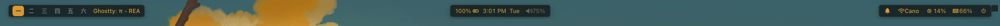
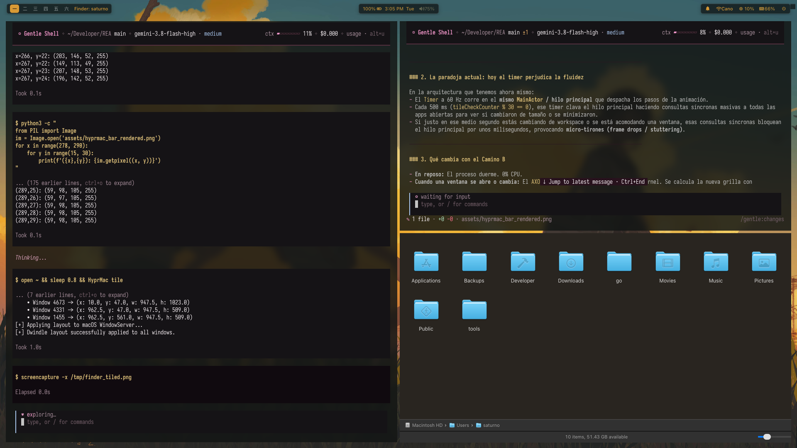
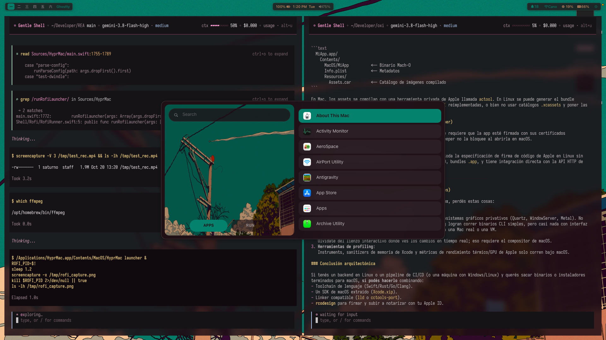
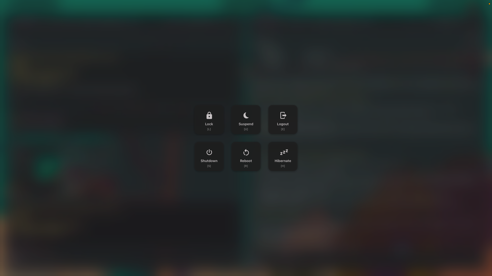
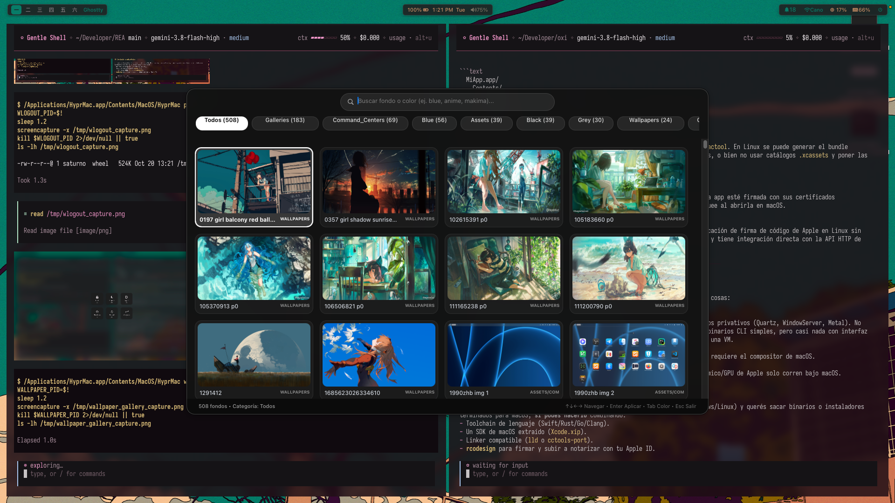

<div align="center">

# HyprMac

**Hyprland-grade compositor composition & tiling for macOS on Apple Silicon.**

*Accessibility handles the layout. WindowServer handles the visual engine.*



<p align="center">
  
  
  
  
  
</p>

</div>

---

## The Pitch

On Linux, a Hyprland rice gives you total control: square corners, zero shadows, Waybar, Rofi, and organic Fibonacci tiling. On macOS, tiling managers (like yabai, Amethyst, or Aerospace) are forced to operate strictly from user-space via Accessibility APIs. While Accessibility is great at moving window frames, it cannot touch the compositor buffer: macOS continues to draw 14px rounded corners, massive drop shadows, and titlebars, resulting in a 1-frame visual flicker whenever a new window spawns.

**HyprMac uses a hybrid architecture:**
- **Accessibility (`AXObserver`)** handles what it does best: window movement, focus detection, and reactive event listening with **0.0% CPU in idle**.
- **In-Situ Compositor Hook (`libhyprserver.dylib`)** handles what Accessibility cannot: interposing `SLSNewWindow` directly inside `WindowServer` so windows are born square, shadowless, and frameless from microsecond zero.
- **Client AppKit Hook (`libhyprclient.dylib`)** strips internal titlebars and injects modern desktop enhancements (like the auto-collapsing Zen Drawer for Finder).
- **A Complete Linux Rice Suite**: You don't need to stitch together 4 disconnected tools. HyprMac ships with a native Waybar status bar, Rofi modal launcher, Wlogout power menu, and FSEvents wallpaper watcher out of the box.

---

## The 4 Core Pillars

1. **Zero-Flicker Window Styling**  
   Windows are born square and shadowless at `SLSNewWindow` interposition time directly inside the root compositor daemon (`WindowServer`, UID 88). No 1-frame cosmetic flash.

2. **Efficient Hybrid Architecture (0.0% Idle CPU)**  
   Zero polling loops. Window movements, title changes, tab switches, and minimization are streamed via native macOS `AXObserver` and `NSWorkspace` notifications. Dual lock-free shared memory (`/tmp/hyprmac-ipc.shm`) bridges Swift and the compositor without sandbox violations.

3. **Complete Wayland Rice Suite Built-in**  
   - **HyprBar**: Translucent floating Waybar capsules with background blur, active window title/icon, battery, volume, Wi-Fi, hardware load (CPU/RAM), and notification center indicator.
   - **Rofi Launcher**: Fuzzy application finder, system command runner, math calculator, and window switcher.
   - **Wlogout**: Fullscreen Wayland-style power menu modal (Lock, Sleep, Logout, Reboot, Shutdown).
   - **Wallpaper Gallery & Watcher**: Visual wallpaper grid with automatic Pywal/Matugen palette generation on change.
   - **Zen Drawer**: Auto-collapsing floating sidebar drawer for Finder.

4. **Native `hyprland.conf` Parsing**  
   Bring your existing Hyprland keybinds, modifiers, gaps, and rules directly into macOS without learning a new configuration language.

---

## Technical Comparison

| Feature | **HyprMac** | **yabai** | **Aerospace** | **Amethyst** |
| :--- | :---: | :---: | :---: | :---: |
| **Architecture** | **Hybrid (In-situ `WindowServer` + Reactive AX)** | User-space + Scripting Addon | User-space (AX API) | User-space (AX API) |
| **Window Layout Engine** | **Accessibility API (`setWindowFrame`)** | Accessibility API | Accessibility API | Accessibility API |
| **Corner & Shadow Styling** | **Compositor Hook (`SLSNewWindow`)** | Delayed cosmetic overlay | Unmodified macOS Aqua | Unmodified macOS Aqua |
| **New Window Flicker** | **Zero (styled at creation time)** | 1-frame visible flash | N/A | N/A |
| **Menu Bar Suppression** | **Native reveal = 0.0 (`WindowServer`)** | macOS auto-hide setting | macOS auto-hide setting | None |
| **Full Wayland Suite** | **Built-in (Bar, Rofi, Wlogout, Gallery)** | Tiling only (needs external tools) | Tiling only | Tiling only |
| **Tiling Engine** | **Dwindle / Fibonacci (Hyprland)** | BSP / Float / Stack | i3-style tree | Predefined columns |
| **Idle CPU Utilization** | **0.0% (100% Event-driven `AXObserver`)** | Periodic polling & AX queries | Polling / IPC | Continuous polling |
| **Config Syntax** | **`hyprland.conf` compatible** | Custom CLI commands | Custom TOML | macOS GUI prefs |

---

## Architecture Overview

```
┌────────────────────────────────────────────────────────────────────────┐
│                         macOS Desktop Session                          │
├────────────────────────────────────────────────────────────────────────┤
│                                                                        │
│  ┌───────────────────────┐   Lock-Free SHM Ring   ┌─────────────────┐  │
│  │     HyprMac CLI       │◄── /tmp/hyprmac-ipc ──►│ libhyprserver   │  │
│  │    (Swift 6 Daemon)   │       .shm (64KB)      │ .dylib (Inside  │  │
│  │                       │                        │  WindowServer)  │  │
│  │  • Dwindle Layout     │  ┌──────────────────┐  │                 │  │
│  │  • AXEventObserver    │  │   Command Ring   │  │ • SLSNewWindow  │  │
│  │  • HyprBar Window     │─►│   28KB Swift→WS  │─►│   Interposition │  │
│  │  • Rofi & Wlogout     │  └──────────────────┘  │ • Square Corners│  │
│  │  • Session Manager    │  ┌──────────────────┐  │ • Strip Shadows │  │
│  │  • Effects Manager    │◄─│   Response Ring  │◄─│ • MenuBar Lock  │  │
│  │    (Opacity/Blur)     │  │   28KB WS→Swift  │  │ • GPU Transforms│  │
│  └───────────────────────┘  └──────────────────┘  └─────────────────┘  │
│             ▲                                              ▲           │
│             │                                              │           │
│  ┌──────────┴───────────┐                         ┌────────┴────────┐  │
│  │       AXObserver     │                         │   hypr-inject   │  │
│  │  (Reactive OS Events)│                         │  (Mach Loader)  │  │
│  └──────────────────────┘                         └─────────────────┘  │
│             ▲                                              ▲           │
│             │                                              │           │
│  ┌──────────┴───────────┐                         ┌────────┴────────┐  │
│  │       CGEventTap     │                         │ libhyprclient   │  │
│  │  (Global Hotkeys)    │                         │ (Per-App Hook)  │  │
│  └──────────────────────┘                         │ • Strip Titlebar│  │
│                                                   │ • Zen Drawer    │  │
│                                                   └─────────────────┘  │
└────────────────────────────────────────────────────────────────────────┘
```

---

## Prerequisites

Before running the installer, two one-time system settings are required on Apple Silicon:

1. **System Integrity Protection (SIP) Disabled**:
   - Restart your Mac and hold the Power / Touch ID button to enter **Recovery Mode**.
   - Open **Utilities ➔ Terminal** and run:
     ```bash
     csrutil disable
     ```
   - Restart normally. *(Required to obtain task port access for root `WindowServer` composition hooks).*

2. **ARM64e Preview ABI Enabled**:
   - In your regular macOS Terminal, run:
     ```bash
     sudo nvram boot-args="-arm64e_preview_abi"
     ```
   - Restart your Mac. *(Required on macOS 14+ / 15+ to load custom ARM64e pointer-authenticated dynamic libraries).*

*Note: Xcode Command Line Tools (`xcode-select --install`) is only required if compiling from source.*

---

## Quick Install (Automated)

Run the automated installer to set up binaries and background services:

```bash
git clone https://github.com/commonriskpro/HyprMac.git
cd HyprMac
./install.sh
```

Or extract and install from a pre-built release package:
```bash
tar -xzf HyprMac-arm64e.tar.gz
./install.sh
```

### What `install.sh` does:
1. **Verifies Code Signature**: Ensures binaries are signed with an Apple Developer ID Application certificate. *(Ad-hoc signatures are never used, ensuring macOS Accessibility / TCC permissions persist across reboots).*
2. **Deploys Binaries & App**: Installs `hypr-inject` and `libhyprserver.dylib` to `/usr/local/`, places `HyprMac.app` in `/Applications/`, and symlinks the global `hyprmac` CLI.
3. **Installs System LaunchDaemon** (`/Library/LaunchDaemons/com.hyprmac.inject.plist`): Injects the compositor hook into `WindowServer` on system boot and maintains a lightweight privileged helper daemon (`/tmp/hyprmac-inject.sock`) for sub-millisecond, zero-process client window decoration stripping.
4. **Installs User LaunchAgent** (`~/Library/LaunchAgents/com.hyprmac.daemon.plist`): Automatically launches the desktop daemon (HyprBar, hotkeys, Dwindle tiling) upon user login.

---

### Mandatory Post-Installation Steps (macOS Permissions)

macOS enforces strict TCC (Transparency, Consent, and Control) security policies that Apple prohibits scripts from granting automatically:

1. **Accessibility Permission (Mandatory)**:
   - Open **System Settings ➔ Privacy & Security ➔ Accessibility**.
   - Enable the toggle for **HyprMac.app**.
   *(Required for global keybind event taps, active window focus detection, and window placement).*

2. **Location Services Permission (Optional)**:
   - Open **System Settings ➔ Privacy & Security ➔ Location Services**.
   - Enable access for **HyprMac.app** if you want HyprBar to display the exact Wi-Fi SSID name. *(If omitted, HyprBar uses kernel-level `NWPathMonitor` to display connection state without polling).*

To uninstall completely at any time:
```bash
./uninstall.sh
```

---

## Usage

### Daily Driver (Zero-Maintenance)
Once installed via `install.sh`, **no manual terminal commands are needed**:
- When your Mac boots, the LaunchDaemon silently hooks `WindowServer`.
- When you log into your user account, the LaunchAgent starts HyprBar and the tiling engine.

### CLI Commands & Controls

```bash
# Check WindowServer hook IPC status
hyprmac server-status

# Open modal fuzzy launcher (Alt + Space)
hyprmac launcher

# Open fullscreen power menu modal
hyprmac powermenu

# Open wallpaper theme selector
hyprmac wallpaper

# Check active window bounds & tags
hyprmac probe

# Force-retile visible windows
hyprmac tile
```

---

## Building from Source (Developers)

If you are developing HyprMac or modifying native C hooks:

```bash
# 1. Build injector, compositor hook, client decoration, and Swift 6 daemon
make all

# 2. Install both LaunchDaemon and LaunchAgent
sudo make install

# 3. Create distributable release package
make package
```

---

## Key Features

### 🪟 Fibonacci / Dwindle Tiling
Windows automatically tile in organic binary-tree spirals according to aspect ratio, born 100% frameless, square, and shadowless directly from `WindowServer`. Supports directional focus (`Alt + H/J/K/L`), window swaps (`Alt + Shift + H/J/K/L`), fullscreen toggle (`Alt + F`), floating toggle (`Alt + V`), split ratio adjustments, and smooth mouse drag-and-drop.

<p align="center">
  
</p>

### 📊 HyprBar (Waybar for macOS)
Three independent floating translucent glass capsules rendered with native AppKit and behind-window blur:
- **Left Island**: Japanese Kanji workspaces (`一` to `六`) with active indicator pill and compact active window title/icon.
- **Center Island**: Battery telemetry & charging indicator, live clock & day, and system volume level.
- **Right Island**: Notification center badge, Wi-Fi SSID, live hardware telemetry (CPU & RAM load), and Wlogout power menu launcher.

<p align="center">
  
</p>

### 🚀 Built-in Rofi Launcher (`HyprMac launcher`)
Modal fuzzy launcher (`Alt + Space`) scanning macOS applications, command-line binaries, math expressions (`= 24 * 1024`), system power commands, and wallpaper switcher.

<p align="center">
  
</p>

### ⚡ Wlogout Power Menu (`HyprMac powermenu`)
Modal fullscreen overlay providing Lock, Suspend, Logout, Reboot, and Shutdown actions.

<p align="center">
  
</p>

### 🖼️ Dynamic Wallpaper Theming & Gallery (`HyprMac wallpaper`)
Watches `~/Library/Application Support/com.apple.wallpaper/Store` using kernel `FSEvents` (0% CPU). On wallpaper change, it extracts dominant palette colors and regenerates live themes. Includes a visual modal gallery to preview and switch backgrounds.

<p align="center">
  
</p>

---

## Verification & Tests

HyprMac includes an extensive test suite verifying mathematical tiling bounds, IPC protocol framing, config parsing, and event handling:

```bash
# Run complete test suite (276 tests)
swift test

# Run C harness for SHM IPC ring buffer
make -C tests
./tests/test_ipc --self-test
```

---

## License

This project is intended for development and educational purposes on Apple Silicon hardware with user-authorized SIP modifications.
