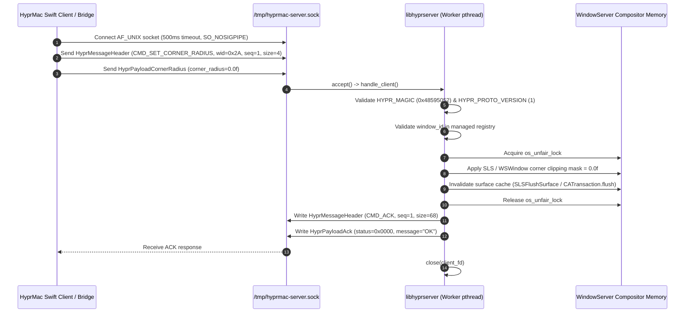

# Software Design Document (SDD): windowserver-insitu-composition

## Architecture Overview

### 1.1 Technical Approach & System Decomposition
The `windowserver-insitu-composition` subsystem operates as a high-leverage architectural seam inside `WindowServer` (`/System/Library/PrivateFrameworks/SkyLight.framework/Resources/WindowServer`). Rather than struggling against client-side IPC filtering in `SkyLight.framework`, we execute inside the compositor's own address space.

The system is partitioned into three decoupled modules:
1. **The Injector (`hypr-inject`):** Ephemeral privileged loader running as root (UID 0). Performs pre-flight safety validation (SIP disabled, `-arm64e_preview_abi` boot argument, safe-mode tombstone), acquires the target `WindowServer` Mach task port, resolves `pthread_create_from_mach_thread` and `dlopen` from the shared cache, computes the ASLR shared cache slide delta across process boundaries, allocates remote execution pages (16KB stack, 4KB code containing a two-stage assembly sequence), configures PAC-signed register state (`PC=remote_code`, `SP=remote_stack + 8192`), converts thread state across PAC domains via `_thread_convert_thread_state`, dispatches execution via `thread_create_running` (macOS ≥ 14.4) or `thread_set_state`+`thread_resume` (macOS < 14.4), polls for the Stage 1 readiness marker (`0x79616265`), waits for socket creation (`/tmp/hyprmac-server.sock`), terminates the spinning Mach thread, and verifies post-load stability via a 500ms crash watchdog.
2. **The In-Process Hook (`libhyprserver.dylib`):** Resident library running inside `WindowServer` (UID 88 / `_windowserver`). Upon initialization via `__attribute__((constructor))`, spawns a detached POSIX worker thread, hosts a local Unix Domain Socket at `/tmp/hyprmac-server.sock`, and executes window attribute modifications (corner radius, shadow state, borders, titlebar stripping) with native server-level credentials.
3. **The Client Bridge (`HyprServerBridge.swift`):** Pure Swift client integrated into `HyprMac` that wraps the binary wire protocol into type-safe, asynchronous methods, monitoring `NSWorkspace` notifications for focus synchronization with automatic reconnection and fallback to `SkyLightBridge`.

> **Socket Path & Permissions Invariant:** The IPC socket is located at `/tmp/hyprmac-server.sock` rather than `/var/run/hyprmac-server.sock`. `WindowServer` runs as UID 88 (`_windowserver`), which cannot create files in `/var/run` (owned by root, mode `0755`). `/tmp` is world-writable (`1777`), enabling the in-process hook running as `_windowserver` to bind its Unix domain socket without requiring root privileges while enforcing `0666` permissions for client processes.
>
> *Note:* The socket uses mode `0666` because WindowServer (UID 88) must accept connections from unprivileged user processes (UID 501). Authentication is enforced at the wire protocol level via a shared secret token injected alongside the dylib path (`HYPR_CMD_AUTH` [PLANNED]).

### 1.2 Architecture Decisions

| Decision | Choice | Alternatives Considered | Rationale |
|---|---|---|---|
| Injection Target | `WindowServer` directly (UID 88 / `_windowserver`). | Target `Dock.app` or inject individual GUI applications. | Dock lacks access to internal `WSWindow` clipping masks; per-application injection requires hooking every running and future process, which is fragile and incomplete for non-AppKit binaries. |
| Injection Vector | Two-Stage PAC-safe loader with ASLR shared cache slide correction (`task_for_pid` + `mach_vm_allocate` + `mach_vm_write` + `_thread_convert_thread_state` + `thread_create_running` + `pthread_create_from_mach_thread` → `dlopen`). | Direct `dlopen` on raw Mach thread, or `DYLD_INSERT_LIBRARIES` via `launchd.plist`. | Direct `dlopen` on a raw Mach thread crashes WindowServer fatally because externally created Mach threads lack initialized Thread-Specific Data (`TPIDRRO_EL0 = 0`), causing `pthread_getspecific` within dyld/dlopen to dereference NULL. The two-stage loader uses a raw Mach thread (Stage 1) to invoke `pthread_create_from_mach_thread` (which possesses an internal bypass to instantiate a real pthread with full TLS), which then runs Stage 2 on the real pthread to safely execute `dlopen(path, RTLD_LAZY)`. `launchd.plist` modifications risk unbootable recovery loops. |
| IPC Protocol | Unix Domain Socket with fixed-width binary header and token authentication. | Mach Messages (`mach_msg`) or XPC. | Custom Mach MIG requires complex IDL bindings; XPC requires Launchd registration and code-signing entitlements. Unix domain sockets are fast (<20μs latency), simple, and support POSIX permissions (`0666` with wire-level shared secret authentication). |
| Threading & Concurrency Model | Dedicated background worker thread with sequential `accept()` (CURRENT). Planned migration to `kqueue` event loop in Phase 4. | Hooking `WindowServer`'s main runloop or sequential `accept()` without worker thread. | Running on the main runloop introduces frame drop risks. Spawning a detached worker thread isolates IPC I/O from compositor frame rendering. |
| Failsafe Strategy | File-based circuit breaker (`/tmp/hyprmac.safemode`) + post-load PID watchdog + automatic client fallback. Signal sandboxing via `sigaction` [PLANNED]. | Kernel watchdogs or automatic restart scripts. | A filesystem tombstone is instantly verifiable with zero dependencies; PID sampling detects immediate crashes; client falls back to `BorderWindow` overlays on disconnect. |

### 1.3 Loader Architecture: Two-Stage PAC-Safe Dynamic Library Loading

#### Why Direct dlopen on Raw Mach Threads Fails
Prior loader patterns attempted to execute `dlopen` directly on an externally created Mach thread via `thread_create` / `thread_create_running`. On ARM64e macOS (macOS 14.4+ Sonoma and macOS 27 Golden Gate), **direct dlopen on a raw Mach thread crashes `WindowServer` fatally**.

In Darwin's threading implementation (`libsystem_pthread`), Mach threads created externally via kernel task ports lack an initialized POSIX thread structure (`pthread_t`) and Thread-Specific Data (TSD) block. On ARM64e, the hardware thread pointer register `TPIDRRO_EL0` (which points to the TSD block) is zero (`NULL`). During dynamic library loading, `dyld` and `libsystem` internally invoke `pthread_getspecific` or related TLS lookups. `pthread_getspecific` dereferences `TPIDRRO_EL0 + 4` (or `+ 16`), which immediately triggers an unhandled `EXC_BAD_ACCESS (SIGSEGV)` page fault at `0x0000000000000010`. Because `WindowServer` is a critical platform daemon, this crash causes `launchd` to terminate the graphical session, dumping the user to the login window.

#### The Architectural Solution: Two-Stage ARM64e Assembly Sequence
To eliminate the TLS crash invariant, `hypr-inject` uses a proven two-stage architecture (based on the ARM64e loader pattern by Jeremy Legendre in yabai, enhanced with ASLR shared cache slide delta correction):
- **Stage 1 (Raw Mach Thread):** Executes a minimal assembly sequence on the raw Mach thread. It calls `pthread_create_from_mach_thread`, which has a dedicated Libsystem initialization pathway specifically engineered to transition an uninitialized Mach thread into a fully valid POSIX thread with complete TLS/TSD. It passes the Stage 2 entry point as the start routine, moves the readiness marker `0x79616265` (`"yabe"`) into register `x0`, and enters an infinite spin loop.
- **Stage 2 (Real POSIX Thread with TLS):** Executes on the newly created POSIX thread where `TPIDRRO_EL0` is fully initialized. Stage 2 sets arguments (`x0 = &dylib_path`, `x1 = RTLD_LAZY (1)`), executes `dlopen` via `blr`, and returns cleanly via `retab`.

#### 1. Remote Page Allocations
`hypr-inject` allocates two distinct memory regions in `WindowServer` address space:
1. **Remote Stack Page (16KB):** Allocated via `mach_vm_allocate(task, &remote_stack, 16384, VM_FLAGS_ANYWHERE)` and protected via `vm_protect(task, (vm_address_t)remote_stack, 16384, 1, VM_PROT_READ | VM_PROT_WRITE)`. Provides stack space for the initial Stage 1 Mach thread.
2. **Remote Code Page (4096 bytes):** Allocated via `mach_vm_allocate(task, &remote_code, 4096, VM_FLAGS_ANYWHERE)`. The page is structured with exact binary offsets matching `native/injector/main.c`:
   - `[0x00..0x57]` (88 bytes, 22 instructions): **Stage 1 Assembly Sequence**. Sets up a stack frame, prepares parameters (`x0 = &pthread_t`, `x1 = NULL`, `x2 = &stage2` signed via `paciza x2`, `x3 = NULL`), loads the slide-corrected address of `pthread_create_from_mach_thread` from offset `0x58`, calls `blr x9`, sets `x0 = 0x79616265` (`movz x0, #0x6265; movk x0, #0x7961, lsl #16`), and enters a spin loop (`adr x9, #0; br x9`).
   - `[0x58..0x5F]` (8 bytes): **Data Slot: `pthread_create_from_mach_thread` address**. Populated at runtime with the slide-corrected remote symbol address.
   - `[0x60..0x9F]` (64 bytes, 16 instructions): **Stage 2 Assembly Sequence**. Starts with `pacibsp`, allocates frame, sets `x1 = 1` (`RTLD_LAZY`), computes `x0 = &dylib_path` (`adr x0, #0x2C`), loads the slide-corrected address of `dlopen` from offset `0xA0`, calls `blr x9`, restores frame, and returns via `retab`.
   - `[0xA0..0xA7]` (8 bytes): **Data Slot: `dlopen` address**. Populated at runtime with the slide-corrected remote symbol address.
   - `[0xA8..end]`: **Dylib Path String**. Null-terminated string containing the absolute path to `libhyprserver.dylib`.
   The code page is written via `mach_vm_write` and protected via `vm_protect(task, (vm_address_t)remote_code, 4096, 0, VM_PROT_READ | VM_PROT_EXECUTE)`.

#### 2. ASLR Shared Cache Slide Delta Resolution
`WindowServer` runs in a separate Mach security session from the loader. While both processes map the dyld shared cache, their shared cache ASLR slides can differ across sessions. Directly using local function addresses across process boundaries results in invalid instruction jumps or PAC authentication traps.

The loader resolves this slide delta deterministically:
1. Queries the target process dyld info:
   ```c
   task_dyld_info_data_t remote_dyld_info;
   mach_msg_type_number_t count = TASK_DYLD_INFO_COUNT;
   task_info(target_task, TASK_DYLD_INFO, (task_info_t)&remote_dyld_info, &count);
   ```
2. Reads `remote_dyld_info.all_image_info_addr` from the target task using `mach_vm_read()` to extract `struct dyld_all_image_infos`.
3. Verifies `remote_infos->version >= 12` and extracts `remote_slide = remote_infos->sharedCacheSlide`.
4. Symmetrically deallocates the read buffer via `vm_deallocate(mach_task_self(), read_data, read_count)` to maintain zero resource leakage.
5. Reads the local slide directly from `mach_task_self()`:
   ```c
   task_info(mach_task_self(), TASK_DYLD_INFO, (task_info_t)&local_dyld_info, &count);
   local_slide = ((struct dyld_all_image_infos *)local_dyld_info.all_image_info_addr)->sharedCacheSlide;
   ```
6. Computes the slide delta:
   ```c
   intptr_t slide_delta = (intptr_t)remote_slide - (intptr_t)local_slide;
   ```
7. Resolves local function pointers via `dlsym(RTLD_DEFAULT, "pthread_create_from_mach_thread")` and `dlsym(RTLD_DEFAULT, "dlopen")`, strips PAC signatures via `ptrauth_strip(addr, ptrauth_key_function_pointer)`, and computes remote virtual addresses:
   ```c
   uint64_t remote_pcfmt  = pcfmt_addr  + slide_delta;
   uint64_t remote_dlopen = dlopen_addr + slide_delta;
   ```
   These slide-corrected addresses are written directly into the code page data slots at offsets `0x58` and `0xA0`.

#### 3. PAC Signing Chain & Thread State Conversion
On Apple Silicon (ARM64e), pointers in thread execution state must carry valid PAC signatures:
1. **Initial Register Signing (`ptrauth_sign_unauthenticated`):**
   The loader configures the initial `arm_thread_state64_t` registers:
   - `PC`: Set to `remote_code` (entry point of Stage 1 assembly sequence at offset `0x00`), signed with PAC key `asia` using the loader's local PAC domain:
     ```c
     __darwin_arm_thread_state64_set_pc_fptr(
         thread_state,
         ptrauth_sign_unauthenticated((void *)remote_code, ptrauth_key_asia, 0));
     ```
   - `SP`: Set to the midpoint of the allocated stack (`remote_stack + 8192`), 16-byte aligned.
2. **PAC Domain Conversion (`_thread_convert_thread_state`):**
   Because the PAC signature generated by `ptrauth_sign_unauthenticated` belongs to the loader's PAC key context, the target process hardware will reject it. The loader invokes the private kernel function `_thread_convert_thread_state` (dynamically loaded from `/usr/lib/system/libsystem_kernel.dylib`):
   ```c
   kr = _thread_convert(thread, 2 /* THREAD_CONVERT_THREAD_STATE_FROM_SELF */,
                        ARM_THREAD_STATE64,
                        (thread_state_t)&thread_state, flavor_count,
                        (thread_state_t)&machine_state, &machine_count);
   ```
   The kernel strips the loader's PAC signature and re-signs `PC` and `LR` using the target `WindowServer` process's PAC keys, storing the result in `machine_state`.
3. **Thread Launch (`thread_create_running`):**
   - On macOS ≥ 14.4 (including macOS 27 Golden Gate), the initial dummy thread is terminated via `thread_terminate(thread)`, and the new thread is spawned running directly with the converted machine state:
     ```c
     thread_create_running(task, ARM_THREAD_STATE64, (thread_state_t)&machine_state, machine_count, &thread);
     ```
   - On macOS < 14.4, state is applied via `thread_set_state` followed by `thread_resume`.
   The hardware authenticates the kernel-signed `PC` in the target process domain and immediately begins executing Stage 1 assembly.

#### 4. Execution, Readiness Polling & Teardown
1. **Stage 1 Execution:** The raw Mach thread executes Stage 1 instructions, calling `pthread_create_from_mach_thread(&thread, NULL, stage2, NULL)`. Once the call returns, Stage 1 loads `0x79616265` (`CODE_MARKER_VALUE`, `"yabe"`) into `x0` and loops indefinitely (`adr x9, #0; br x9`).
2. **Stage 2 Execution:** The new POSIX thread begins executing Stage 2 at offset `0x60`. With a valid `pthread_t` and initialized TSD (`TPIDRRO_EL0 != 0`), it invokes `dlopen(path, RTLD_LAZY)`.
3. **Constructor Initialization:** `dyld` loads `libhyprserver.dylib`, invoking its `__attribute__((constructor))` (`hypr_server_init`). The constructor immediately spawns a detached worker pthread (`deferred_init`) to manage the Unix domain socket, returning quickly. Stage 2 completes and exits cleanly via `retab`.
4. **Readiness Marker Polling:** The loader pauses 10ms, then polls `thread_get_state(thread)` up to 10 iterations (20ms intervals) checking whether `poll_state.__x[0] == 0x79616265`. Finding the marker confirms that Stage 1 successfully invoked `pthread_create_from_mach_thread` and entered the spin loop.
5. **Socket Wait & Mach Thread Termination:** The loader polls for the existence of `/tmp/hyprmac-server.sock` (up to 100 iterations × 100ms = 10s). Once the socket appears, the loader terminates the spinning Stage 1 Mach thread via `thread_terminate(thread)`.
6. **Watchdog Verification:** Remote pages remain allocated to guarantee stability. The loader sleeps for 500ms and re-checks `find_windowserver_pid()`. If the PID matches, loading succeeded cleanly and the loader exits with code 0.

### 1.4 Multi-Monitor Display Synchronization
Apple Silicon systems frequently operate with heterogeneous displays: built-in Liquid Retina XDR displays featuring ProMotion (variable refresh rate scaling dynamically up to 120Hz, ~8.33ms nominal interval) paired with one or more external monitors operating at fixed refresh rates (e.g., 60Hz at ~16.67ms or 144Hz at ~6.94ms). In-situ window border rendering and decoration adjustments cannot assume a single global tick or vsync interval.

In `WindowServer`, each active display (`CGDirectDisplayID`) manages an independent hardware vblank clock domain driven by its own `CADisplay` / `CVDisplayLink` thread. When an application window is modified (e.g., corner radius zeroed, border color updated on focus change), the hook avoids blocking synchronization against an arbitrary display's vblank. Instead, window mutations update the window's backing `CGSWindow` / `WSWindow` properties under `os_unfair_lock`, allowing the specific display engine servicing that window's visible bounds to composite the updated frame on its next immediate vblank tick.

When a managed window spans or transitions between monitors with differing refresh rates and Retina scaling factors (e.g., @2x ProMotion display to @1x 60Hz external display), `WindowServer` splits compositor rasterization across displays. By operating directly on the compositor's underlying window geometry and clipping masks in-situ rather than running an out-of-process client overlay window (which suffers from multi-display synchronization lag and coordinate drift), the decoration state remains coherent across both display regions without tearing, stutter, or coordinate judder.

---

## IPC & Sequence Flow

### 2.1 Mach Injection Sequence Flow

```mermaid
sequenceDiagram
    autonumber
    participant Injector as hypr-inject (Root / UID 0)
    participant WS as WindowServer (UID 88 / ARM64e)
    participant Kernel as Darwin Kernel / Mach Subsystem

    Injector->>Injector: Pre-flight checks (root, SIP, -arm64e_preview_abi, safemode)
    Injector->>Kernel: bootstrap_look_up("com.hyprmac.server.hook") [PLANNED]
    Injector->>Kernel: task_for_pid(mach_task_self(), ws_pid, &task)
    Kernel-->>Injector: task port
    Injector->>Injector: dlsym(pcfmt, dlopen) + ptrauth_strip()
    Injector->>Kernel: task_info(TASK_DYLD_INFO) + mach_vm_read(dyld_all_image_infos)
    Injector->>Injector: Compute ASLR slide delta = remote_slide - local_slide
    Injector->>Kernel: mach_vm_allocate(task, &remote_stack, 16KB, RW)
    Injector->>Kernel: mach_vm_allocate + mach_vm_write(task, &remote_code, 4KB, RX)<br/>(Stage 1 + data slots + Stage 2 + dylib path)
    Injector->>Injector: Configure thread_state (PC=remote_code, SP=remote_stack+8KB)
    Injector->>Injector: Sign PC with ptrauth_sign_unauthenticated(remote_code, asia)
    Injector->>Kernel: thread_create(task, &thread)
    Injector->>Kernel: _thread_convert_thread_state(thread, 2, ARM_THREAD_STATE64, ...)
    alt macOS >= 14.4 / macOS 27
        Injector->>Kernel: thread_terminate(thread)
        Injector->>Kernel: thread_create_running(task, ARM_THREAD_STATE64, &machine_state, &thread)
    else macOS < 14.4
        Injector->>Kernel: thread_set_state(thread, ARM_THREAD_STATE64, &machine_state)
        Injector->>Kernel: thread_resume(thread)
    end
    WS->>WS: Stage 1 (Mach thread): pthread_create_from_mach_thread(&t, NULL, stage2, NULL)
    WS->>WS: Stage 1: Write marker 0x79616265 to x0 -> spin loop (adr x9, #0; br x9)
    WS->>WS: Stage 2 (POSIX thread with TLS): dlopen(remote_path, RTLD_LAZY)
    WS->>WS: libhyprserver constructor (__attribute__((constructor)))
    WS->>WS: Spawn deferred_init worker pthread via pthread_create
    WS->>WS: Bind & listen on /tmp/hyprmac-server.sock (mode 0666)
    WS->>WS: Stage 2 returns via retab
    loop Poll Stage 1 Marker (up to 200ms)
        Injector->>Kernel: thread_get_state(thread) -> check x0 == 0x79616265
    end
    loop Polling up to 10s (100 * 100ms)
        Injector->>Injector: access("/tmp/hyprmac-server.sock", F_OK)
    end
    Injector->>Kernel: thread_terminate(thread) [terminate spinning Stage 1 thread]
    Injector->>Injector: Sleep 500ms; verify WindowServer PID unchanged (watchdog)
```

### 2.2 IPC Server Model

#### Current State: Blocking Sequential `accept()`
The resident server hook `libhyprserver.dylib` currently implements a sequential, blocking socket model on a dedicated POSIX thread:
1. **Deferred Initialization:** The dylib constructor (`hypr_server_init`) spawns `deferred_init` via `pthread_create` and returns immediately to keep dylib loading non-blocking.
2. **Socket Setup:** After a 500ms startup delay, `deferred_init` checks `/tmp/hyprmac.safemode`. If clear, it unlinks stale sockets, creates an `AF_UNIX` stream socket, binds to `/tmp/hyprmac-server.sock`, applies `chmod 0666`, sets a backlog of 16, and spawns `accept_loop`.
3. **Sequential Connection Loop:** `accept_loop` invokes blocking `accept(server_fd, NULL, NULL)`. When a client connects:
   - It calls `handle_client(client_fd)` synchronously.
   - `handle_client` reads framed `HyprMessageHeader` packets using `read_all()`.
   - Magic and version fields are validated.
   - The command is executed or logged, and a response (`send_ack` or `send_pong`) is returned via `write_all()`.
   - Upon connection closure or protocol error, `handle_client` exits and `accept_loop` calls `close(client_fd)` before accepting the next connection.

> **Server-Side Socket Timeouts [PLANNED]:**
> In the current implementation of `hook.c`, `handle_client` executes blocking `read_all()` and `write_all()` without per-socket timeouts. To protect `WindowServer` from malicious or stalled client connections that could permanently occupy the listener thread, server-side socket timeouts (`SO_RCVTIMEO` and `SO_SNDTIMEO` set to 1000ms via `setsockopt`) are required but currently marked as `[PLANNED]`.

> **NOTE / TODO: Phase 4 kqueue Migration [PLANNED]**
> While sequential `accept()` on a dedicated worker thread completely avoids blocking WindowServer's compositor render threads, a stalled or misbehaving client connection can temporarily block subsequent IPC requests. Phase 4 plans to replace this loop with a non-blocking `kqueue` event loop (`EVFILT_READ` on `server_fd` and non-blocking client descriptors) to multiplex concurrent connections and support persistent connection pooling.

### 2.3 Runtime Window Modification Flow



### 2.4 Compositor Surface Cache Invalidation Strategy
In macOS's compositor architecture, window contents and decorations are cached across GPU surfaces managed by QuartzCore (`CAWindowServer`) and SkyLight. Mutating internal window flags or zeroing clipping masks (`WSWindow` corner mask) in memory does not automatically cause the GPU compositor to invalidate its cached raster tiles. Without explicit surface invalidation, visual changes may not render until the client application next posts a new frame buffer or triggers a window move.

To force immediate compositor re-rasterization upon IPC command execution:
1. **Primary Invalidation:** Invoke `SLSFlushSurface()` or `SLSReassociateWindowsWithSpaces()` using the hook's in-process server-level connection (`SLSMainConnectionID()`), marking the window's composited layer hierarchy as dirty.
2. **Transaction Flush:** Commit an explicit CoreAnimation transaction via `CATransaction.flush()` / `CA::Transaction::commit()` within the compositor context to ensure the modified layer properties are immediately submitted to Metal render passes.
3. **Forced Redraw Fallback:** If direct surface flush symbols are non-exported or unresolved on a given OS build, trigger forced invalidation via `SLSMoveWindow()` with a zero coordinate delta `(dx=0, dy=0)`. This forces `WindowServer`'s damage tracking system to recalculate visible window regions and issue a full repaint on the subsequent display frame.

Surface invalidation must occur immediately after releasing the `os_unfair_lock` that protects window attribute mutation. Holding synchronization locks during GPU surface flushes or IPC callbacks would stall WindowServer's render thread, introducing dropped frames (jank).

### 2.5 Window Lifecycle Event Detection, Interposition & Global Decoration Policy
Imperative commands (`HYPR_CMD_SET_CORNER_RADIUS`, `HYPR_CMD_SET_SHADOW_STATE`) require external knowledge of window IDs and operate after a window is already visible. To eliminate the "flash of native decoration" on newly created windows:
- **In-Process Interposition:** The hook SHOULD install an in-process interposition on `SLSNewWindow` / `CGSNewWindow` (or the internal `WSCreateWindow` path discovered in Phase 3) to intercept window creation events.
- **Pre-Composite Decoration Policy via `HYPR_CMD_SET_GLOBAL_POLICY` [PLANNED]:**
  To configure the default decoration applied by `SLSNewWindow` interposition, the protocol defines `HYPR_CMD_SET_GLOBAL_POLICY (0x0015)` with payload `HyprPayloadGlobalPolicy` (18 bytes). When an application creates a window, the hook applies this policy synchronously before the window's first frame is submitted to the compositor, ensuring zero visual flicker or Aqua frame flash.
- **Window Destruction Eviction:** When an application closes or unmaps a window, `WindowServer` destroys the underlying `CGSWindow` structure. The hook maintains an in-memory hash map of active managed window IDs. Commands targeting closed or destroyed windows return `HYPR_ERR_INVALID_WID` (`0x0001`) immediately without dereferencing invalid pointers.

### 2.6 Focus State Synchronization [PLANNED]
> **Status: Not Yet Implemented in hook.c**

Window border rendering distinguishes between active (focused) and inactive windows using the dual-color parameters in `HyprPayloadBorder` (`color_active` and `color_inactive`).
- **Command:** `HYPR_CMD_SET_WINDOW_FOCUS (0x0014)` with a 4-byte payload `HyprPayloadFocus` containing `{ uint32_t window_id; }` (in payload, not 0 bytes), ensuring explicit window target identification independent of header routing.
- **Event Source:** The Swift client bridge (`HyprServerBridge`) monitors `NSWorkspace` focus change notifications (`NSWorkspace.didActivateApplicationNotification`, `NSWorkspace.activeSpaceDidChangeNotification`, and window focus change events via accessibility observers) and sends `HYPR_CMD_SET_WINDOW_FOCUS` whenever the focused window changes.
- **Hook Handling:** On receiving `HYPR_CMD_SET_WINDOW_FOCUS`, the in-process hook updates its internal focus tracking state, repainting the newly focused window with `color_active` and demoting previously focused managed windows to `color_inactive`.

### 2.7 Wire Authentication Handshake [PLANNED]
> **Status: Not Yet Implemented in hook.c**

Socket connections at `/tmp/hyprmac-server.sock` are created with mode `0666` so unprivileged user processes (UID 501) can communicate with `WindowServer` (UID 88). To prevent unauthorized local processes from manipulating window hierarchy:
- **Token Injection:** During injection, `hypr-inject` generates a cryptographically secure 16-byte random token and passes it to `libhyprserver.dylib`.
- **Handshake Command:** `HYPR_CMD_AUTH (0x0030)` carries `HyprPayloadAuth` (`uint8_t token[16]`). The client MUST send `HYPR_CMD_AUTH` as the initial packet within 1 second of socket connection.
- **Enforcement:** Connections failing to authenticate within 1 second or supplying an incorrect token are immediately closed.

---

## Memory Layout & Struct Alignment

### 3.1 Wire Protocol Headers (C11)

All protocol structures are strictly aligned to 1-byte boundaries using `#pragma pack(push, 1)` and `__attribute__((packed))`.

```c
#ifndef HYPR_PROTOCOL_H
#define HYPR_PROTOCOL_H

#include <stdint.h>

#define HYPR_MAGIC 0x48595052  // "HYPR" in ASCII
#define HYPR_PROTO_VERSION 1

// Socket path — /tmp because WindowServer runs as UID 88, can't write to /var/run
#define HYPR_SOCKET_PATH "/tmp/hyprmac-server.sock"

// Safe-mode tombstone
#define HYPR_SAFEMODE_PATH "/tmp/hyprmac.safemode"

// Log path for handshake
#define HYPR_LOG_PATH "/tmp/hyprserver.log"
#define HYPR_LOG_PATH_ROTATED "/tmp/hyprserver.log.1"
#define HYPR_LOG_MAX_SIZE (1024 * 1024)  // 1MB rotation threshold
#define HYPR_MAX_PAYLOAD_SIZE 65536      // Maximum incoming payload size (64KB)

// Bootstrap service name for idempotency
#define HYPR_BOOTSTRAP_NAME "com.hyprmac.server.hook"

typedef uint16_t HyprCommand;
enum {
    HYPR_CMD_PING               = 0x0001,
    HYPR_CMD_PONG               = 0x0002,
    HYPR_CMD_ACK                = 0x0003,
    HYPR_CMD_ERROR              = 0x0004,

    // Window Operations [IMPLEMENTED]
    HYPR_CMD_SET_CORNER_RADIUS  = 0x0010,
    HYPR_CMD_SET_SHADOW_STATE   = 0x0011,
    HYPR_CMD_SET_WINDOW_BORDER  = 0x0012,
    HYPR_CMD_STRIP_TITLEBAR     = 0x0013,
    HYPR_CMD_QUERY_WINDOW       = 0x0020,

    // Window Operations [PLANNED]
    HYPR_CMD_SET_WINDOW_FOCUS   = 0x0014, // [PLANNED] Focus synchronization (payload: HyprPayloadFocus, 4 bytes)
    HYPR_CMD_SET_GLOBAL_POLICY  = 0x0015, // [PLANNED] Auto-decorating new windows (payload: HyprPayloadGlobalPolicy, 18 bytes)
    HYPR_CMD_AUTH               = 0x0030  // [PLANNED] Wire authentication handshake
};

// Error codes [IMPLEMENTED]
#define HYPR_ERR_SUCCESS              0x0000
#define HYPR_ERR_INVALID_WID          0x0001
#define HYPR_ERR_INVALID_CMD          0x0002
#define HYPR_ERR_INTERNAL             0x00FF

// Error codes [PLANNED]
#define HYPR_ERR_UNAUTHORIZED         0x0003 // [PLANNED]
#define HYPR_ERR_PAYLOAD_TOO_LARGE    0x0004 // [PLANNED]
#define HYPR_ERR_INVALID_WID_PLANNED  0x0005 // [PLANNED: extended taxonomy]
#define HYPR_ERR_HOOK_UNAVAIL         0x0006 // [PLANNED]
#define HYPR_ERR_RATE_LIMITED         0x0007 // [PLANNED]
#define HYPR_ERR_INTERNAL_PLANNED     0x0008 // [PLANNED: extended taxonomy]
#define HYPR_ERR_NOT_IMPL             0x0009 // [PLANNED]

#pragma pack(push, 1)

typedef struct {
    uint32_t magic;          // HYPR_MAGIC
    uint16_t version;        // HYPR_PROTO_VERSION
    uint16_t command_id;     // HyprCommand
    uint32_t sequence;       // Client-generated sequence number
    uint32_t window_id;      // Target CGWindowID (0 for non-window commands)
    uint32_t payload_size;   // Byte length of trailing payload
} HyprMessageHeader;

typedef struct {
    float corner_radius;     // 0.0f for hard square corners
} HyprPayloadCornerRadius;

typedef struct {
    uint8_t shadow_enabled;  // 0 = disabled, 1 = enabled
} HyprPayloadShadow;

typedef struct {
    float    border_width;   // e.g. 1.0f
    uint32_t color_active;   // ARGB (0xAARRGGBB)
    uint32_t color_inactive; // ARGB
} HyprPayloadBorder;

typedef struct {
    uint8_t strip;           // 1 = strip, 0 = restore
} HyprPayloadStripTitlebar;

// Focus Window Payload [PLANNED]
typedef struct {
    uint32_t window_id;      // Target window ID to focus (4 bytes)
} HyprPayloadFocus;

// Global Decoration Policy Payload [PLANNED]
typedef struct {
    float    corner_radius;   // Default corner radius (e.g. 0.0f)
    uint8_t  shadow_enabled;  // 0 = disabled, 1 = enabled
    float    border_width;    // Default border width (e.g. 1.0f)
    uint32_t color_active;    // Default active border ARGB (0xAARRGGBB)
    uint32_t color_inactive;  // Default inactive border ARGB (0xAARRGGBB)
    uint8_t  strip_titlebar;  // 1 = strip, 0 = keep
} HyprPayloadGlobalPolicy;

// Authentication Payload [PLANNED]
typedef struct {
    uint8_t token[16];        // 16-byte shared secret token
} HyprPayloadAuth;

// Query Window Request Payload
typedef struct {
    // Empty — window_id is in HyprMessageHeader
} HyprPayloadQueryRequest;

// Query Window Response Payload
typedef struct {
    float    corner_radius;
    uint8_t  shadow_enabled;
    uint8_t  titlebar_stripped;
    uint32_t border_color;     // Current active ARGB
    float    border_width;
} HyprPayloadQueryResponse;

// Pong Payload (echoes server state)
typedef struct {
    uint32_t server_version;   // (major << 16 | minor << 8 | patch)
    uint32_t active_windows;
} HyprPayloadPong;

// Ack / Error Payload
typedef struct {
    uint32_t status;         // HYPR_ERR_* code
    char     message[64];
} HyprPayloadAck;

#pragma pack(pop)

#endif // HYPR_PROTOCOL_H
```

### 3.2 Protocol Framing & Response Semantics
- **Sequence Correlation:** All request headers include a client-generated `sequence` number. Response messages set `HyprMessageHeader.command_id` to `HYPR_CMD_ACK` or `HYPR_CMD_ERROR`, matching the client's `sequence` number for unambiguous transaction tracking.
- **Payload Alignment & Validation:** Incoming packets are validated for exact payload sizes (`sizeof(HyprPayloadCornerRadius) == 4`, `sizeof(HyprPayloadShadow) == 1`, `sizeof(HyprPayloadBorder) == 12`, `sizeof(HyprPayloadStripTitlebar) == 1`). Mismatched payload sizes are rejected immediately with `send_ack(..., HYPR_ERR_INTERNAL, "Read err")`.
- **Query Operations:** `HYPR_CMD_QUERY_WINDOW` passes the target window ID in `HyprMessageHeader.window_id` with an empty payload. The response returns `HYPR_CMD_ACK` with `HyprPayloadQueryResponse` (14 bytes), directly unpackable in `HyprServerBridge.swift`.

### 3.3 Pointer Authentication (PAC) on ARM64e
WindowServer runs as an ARM64e platform binary with hardware pointer authentication enabled. Injecting into an ARM64e process and performing dynamic execution requires strict adherence to PAC invariants:
1. **Local Address Resolution & PAC Stripping:** The injector resolves `pthread_create_from_mach_thread` and `dlopen` locally via `dlsym(RTLD_DEFAULT, ...)`. Function pointers resolved in the injector process contain PAC signatures authenticated with the injector's keys and cannot be jumped to in WindowServer. The injector strips PAC bits via `ptrauth_strip(addr, ptrauth_key_function_pointer)` before computing slide-corrected virtual addresses.
2. **ASLR Shared Cache Slide Correction:** Local addresses are adjusted by `slide_delta = remote_slide - local_slide` (extracted via `task_info(TASK_DYLD_INFO)` and `dyld_all_image_infos`) before patching into data slots at offsets `0x58` and `0xA0` in the remote code page.
3. **In-Situ PAC Signing in Stage 1 & Stage 2:** In Stage 1 assembly, the Stage 2 entry point is signed dynamically using `paciza x2` before being passed to `pthread_create_from_mach_thread`. Stage 2 starts with `pacibsp` and returns safely using `retab`.
4. **PAC Domain Conversion (`_thread_convert_thread_state`):** The loader configures initial registers (`PC = remote_code`, signed via `ptrauth_sign_unauthenticated((void *)remote_code, ptrauth_key_asia, 0)`, and `SP = remote_stack + 8192`). It invokes `_thread_convert_thread_state` with direction `2` (`THREAD_CONVERT_THREAD_STATE_FROM_SELF`) so the kernel re-signs the register state in the target process PAC domain.
5. **Hardware Launch:** On macOS ≥ 14.4 (including macOS 27), `thread_create_running` verifies the kernel-re-signed state and loads it directly into hardware registers.

### 3.4 Internal Symbol & Struct Discovery Strategy (Phase 3)
`WSWindow` and `CGSWindow` are private structures whose layouts change across macOS versions. The hook MUST NOT hardcode struct offsets. Instead, Phase 3 employs a multi-strategy discovery approach:
1. **Class-dump / Mach-O introspection:** Use `objc_getClass("CAWindowServer")` and `class_copyIvarList` to discover Objective-C ivar offsets for `CAWindowServerWindow` properties (corner radius, shadow).
2. **Pattern scanning:** For C-struct-only paths, scan the `__DATA` segment of `SkyLight.framework` for known constant patterns adjacent to the target fields.
3. **Hooked accessor functions:** Prefer hooking `SLSSetWindowShape` / `SLSSetWindowShadowProperties` / `CGSSetWindowCornerRadius` (if exported as private symbols) to intercept and override values at the API boundary. This is version-resilient.

### 3.5 Comprehensive Error Taxonomy
The protocol error codes encompass both currently implemented codes (in `protocol.h` and `hook.c`) and planned domain failure modes across client-server interaction:

**Currently Implemented Error Codes:**
- `HYPR_ERR_SUCCESS (0x0000)`: Operation applied cleanly.
- `HYPR_ERR_INVALID_WID (0x0001)`: Specified `window_id` does not exist or has been destroyed.
- `HYPR_ERR_INVALID_CMD (0x0002)`: Unrecognized command ID.
- `HYPR_ERR_INTERNAL (0x00FF)`: Internal compositor fault or allocation failure.

**Planned Error Codes [PLANNED]:**
- `HYPR_ERR_UNAUTHORIZED (0x0003)`: [PLANNED] Client connection failed shared-secret token authentication or exceeded handshake deadline.
- `HYPR_ERR_PAYLOAD_TOO_LARGE (0x0004)`: [PLANNED] Incoming packet payload exceeds maximum boundary (`HYPR_MAX_PAYLOAD_SIZE` = 64KB).
- `HYPR_ERR_INVALID_WID (0x0005)`: [PLANNED] Extended invalid window ID classification.
- `HYPR_ERR_HOOK_UNAVAIL (0x0006)`: [PLANNED] Hook subsystem or compositor hook connection temporarily unavailable.
- `HYPR_ERR_RATE_LIMITED (0x0007)`: [PLANNED] Command mutation rate exceeded safety threshold.
- `HYPR_ERR_INTERNAL (0x0008)`: [PLANNED] Extended internal compositor transaction fault.
- `HYPR_ERR_NOT_IMPL (0x0009)`: [PLANNED] Command recognized but not implemented in current runtime.

---

## Fail-Safe Circuit Breakers

### 4.1 Safe-Mode Circuit Breaker & Crash Watchdog
1. **Safe-Mode Probe:**
   ```c
   if (access("/tmp/hyprmac.safemode", F_OK) == 0) {
       syslog(LOG_WARNING, "[HyprServer] Safe-mode tombstone detected. Aborting hook initialization.");
       return;
   }
   ```
2. **Crash Watchdog in Injector:**
   The injector samples the PID of `WindowServer` before injection and again 500ms after remote thread creation. If the PID has changed, it asserts that a crash occurred, immediately creates `/tmp/hyprmac.safemode`, and outputs a red diagnostic alert without attempting retry loops.

### 4.2 Signal Sandboxing & Fault Recovery [PLANNED]
> **Status: Not Yet Implemented in hook.c [PLANNED]**

Phase 3/4 plans to install `sigaction(SIGSEGV, ...)` with `SA_SIGINFO` on the compositor thread before any pointer dereference of dynamically discovered symbols:
- Uses `sigsetjmp` and `siglongjmp` to recover from segmentation faults.
- Fault Recovery Flow:
  - On fault, catches faulting memory address (`info->si_addr`) and associated symbol.
  - Logs diagnostic context to `/tmp/hyprserver.log` and syslog.
  - Marks that symbol as unavailable in the runtime capability registry.
  - Invokes `siglongjmp` to restore execution state and continues running in degraded mode.
- Prevents unhandled page faults from propagating to Mach exception handlers or the kernel.

### 4.3 Injection Idempotency & Mach Bootstrap Port [PLANNED]
> **Status: Partially Implemented [PLANNED]**

`hypr-inject` contains an idempotency check (`check_hook_loaded()`) that queries `bootstrap_look_up(bootstrap_port, HYPR_BOOTSTRAP_NAME, &port)` using the standardized service name `"com.hyprmac.server.hook"`. If the port exists, loading is skipped and `hypr-inject` exits with status 2. Registration of `com.hyprmac.server.hook` via `bootstrap_register()` / `bootstrap_check_in()` inside `libhyprserver.dylib` is `[PLANNED]` for Phase 2/3.

### 4.4 Thread Safety & Synchronization Locks
The hook's POSIX listener thread receives IPC commands and mutates compositor-internal structures (`WSWindow`, SkyLight layer properties), while WindowServer's render threads traverse these structures on display refresh cycles.
- **Atomic Window Mutation [PLANNED]:** All mutations to window properties (`corner_radius`, `shadow_flags`, `border`) MUST be performed atomically using `os_unfair_lock` (`g_state_lock` in `hook.c`, `[PLANNED]`). Currently, `hook.c` implements only `g_log_lock` to serialize diagnostic logging; `g_state_lock` will be introduced when direct compositor memory mutations are enabled.
- **Minimal Critical Section:** Lock hold time is kept strictly minimal (<5μs) to prevent stalling compositor frame rendering.
- **Structured Logging Synchronization:** File writes to `/tmp/hyprserver.log` are serialized via `g_log_lock` (`os_unfair_lock`).

### 4.5 Dylib Destructor & Clean Unload Path [PLANNED]
> **Status: Not Yet Implemented in hook.c [PLANNED]**

`WindowServer` is a root daemon managed by `launchd` that persists for the entire lifetime of the OS session. Restarting WindowServer forcibly terminates all GUI applications and logs the user out. Therefore, updating `libhyprserver.dylib` during active development or upgrade cycles must support safe teardown and re-injection without terminating WindowServer:
1. **Teardown Protocol via `__attribute__((destructor))` [PLANNED]:**
   While `hook.c` currently implements only `__attribute__((constructor))` (`hypr_server_init`), implementing `__attribute__((destructor))` is planned to ensure clean unloads:
   - Stop IPC Ingestion: Close the listening socket (`g_server_fd`), unlink `/tmp/hyprmac-server.sock`, and terminate the background accept loop thread.
   - Revert Window Decorations: Iterate the managed window registry and restore native macOS attributes—re-enabling Aqua drop shadows (`shadow_enabled = 1`), restoring default rounded corner masks (e.g., 10.0f-12.0f), and clearing custom borders (`border_width = 0.0f`).
   - Release Allocations: Deallocate tracking hash tables, deregister bootstrap ports, and ensure zero dangling pointers or unmapped memory regions remain accessible to compositor traversal threads.
2. **Dynamic Reload Limitations:** While `dlclose()` can decrement the dylib reference count, macOS dynamic linker (`dyld`) semantics do not guarantee physical unloading of shared libraries that have registered Objective-C classes, Mach ports, or thread-local storage blocks. For complete version upgrades where binary layout changes, the system supports disabling old hook mutation handlers and rebinding the socket path to the new version dylib, or coordinating user logout/re-login when deep symbol swizzles are modified.

### 4.6 State Rollback on Unload / Crash [PLANNED]
If the hook terminates or WindowServer restarts:
- **Destructor Restoration [PLANNED]:** The hook's destructor (`__attribute__((destructor))`) attempts to restore all modified windows to their native state (original corner radius, shadows, titlebars).
- **Client Fallback on Abnormal Termination:** If abnormal termination prevents destructor execution, the Swift bridge detects socket disconnection and falls back to `BorderWindow` overlays.
- **Reconciliation on Next Injection:** On next injection, the hook re-enumerates all windows and applies the configured style.

---

## File Changes & Project Organization

| File | Action | Purpose |
|---|---|---|
| `openspec/config.yaml` | Modified | OpenSpec configuration, SDD rules, platform requirements, and sign-off rollback rules. |
| `openspec/changes/windowserver-insitu-composition/proposal.md` | Created | Formal proposal, intent, scope, and rollback. |
| `openspec/changes/windowserver-insitu-composition/design.md` | Modified | This Software Design Document. |
| `openspec/changes/windowserver-insitu-composition/specs/composition-engine.spec.md` | Created | RFC 2119 requirements & Given/When/Then scenarios. |
| `openspec/changes/windowserver-insitu-composition/tasks.md` | Created | Phased implementation task breakdown. |
| `native/injector/main.c` | Created | Two-stage PAC-safe Mach task port loader (`hypr-inject`). |
| `native/server_hook/hook.c` | Created | In-process dylib implementation (`libhyprserver.dylib`). |
| `native/shared/protocol.h` | Created | Common binary wire protocol definitions. |
| `Sources/HyprMac/Bridge/HyprServerBridge.swift` | Created | Swift client driver for socket communication. |
| `Sources/HyprMac/Bridge/SkyLightBridge.swift` | Modify | Forward window decoration mutations to server hook. |
| `Sources/HyprMac/main.swift` | Modify | CLI commands to inspect and trigger server modifications. |
